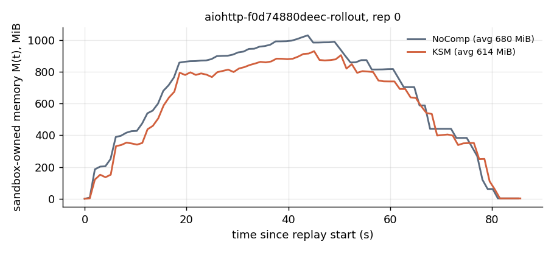

# Phase 4 — replay traces in Zeroboot, measure what KSM saves

Replays a recorded cohort (Phase 3) into Zeroboot sandboxes (Phase 2) and samples
sandbox-owned memory every second, once with KSM off (**NoComp**) and once with
KSM on (**KSM**). This answers the headline question: how much does turning on
KSM save when N coding agents run concurrently from one template?

## Run

```bash
source ../env.sh
T=$TEMPLATES_DIR/aiohttp/f0d74880deec
sudo -E bash run_matrix.sh $T ../traces/aiohttp/f0d74880deec      # 3 reps x {rollout,gaf} x {nocomp,ksm}, ~30 min
$R2E_DIR/.venv/bin/python report.py                               # table -> results/summary.md, plots -> results/mt-*.png
# one run:
sudo -E python3 replay.py --template-dir $T --cohort ../traces/aiohttp/f0d74880deec/rollout --config ksm --rep 0
```

## Method

- **Replay.** All trajectories of the cohort start together, one sandbox each,
  forked from the task template, as in paper §5.2: Rollout's 16 run concurrently,
  GAF's 4 run concurrently. Before each recorded agent command the sandbox sits
  idle for the recorded `think_time_ms_before`. The command then runs through
  `ZerobootRuntime.run`, which wraps it exactly like R2E's `DockerRuntime.run`.
  A sandbox is deleted when its trajectory ends.
- **Configs.**
  - Both configs: fork mappings are `MADV_MERGEABLE` (patch 0003), and serve is
    pinned to NUMA node 0.
  - **NoComp:** `ksm_ctl.sh off`.
  - **KSM:** `ksm_ctl.sh on` (`pages_to_scan=10000`, `sleep_millisecs=20`,
    `merge_across_nodes=1`, `use_zero_pages=0`). This aggressive scan rate gives
    roughly an upper bound on what KSM can find.
  - Runs are interleaved NoComp/KSM within each repetition.
- **What KSM scans** (verified 2026-11-19 via `/proc/<serve>/smaps` VmFlags `mg`):
  - Only each sandbox's **guest-RAM mapping**: a `MAP_PRIVATE` view of the template
    memfd, guest-RAM sized (3 GiB here), marked by patch 0003. Two sandboxes → exactly
    2 of serve's 233 VMAs. Nothing else in serve is mergeable: no heap, stacks or
    libraries, and no process-wide `PR_SET_MEMORY_MERGE`.
  - Firecracker isn't running at all: it's only used once, to boot and snapshot the
    template.
  - Within those mappings KSM can only merge **anonymous** pages, i.e. pages the
    sandbox wrote (CoW copies). Pages still served from the template memfd are shmem
    pages, already shared by all sandboxes and not KSM candidates.
  - Candidates are therefore all private guest memory: guest kernel data, process
    heaps, page cache, files written into the tmpfs root, and pages the guest freed
    (still dirty on the host).
  - ksmd still walks the page tables of the whole 3 GiB per sandbox each pass.
- **Metric** (paper §5.4, without a compression pool): sandbox-owned physical memory
  `M(t) = (serve Anonymous − its value before any sandbox) − pages_sharing × 4 KiB`.
  - `Anonymous` = the forks' copy-on-write private pages.
  - `pages_sharing` = pages KSM deduplicated. The Phase 1b gate showed serve's Pss
    drops by exactly this amount.
  - `M_avg` = average of M(t) over the replay's wall time.
  - `S = 1 − M_avg(KSM)/M_avg(NoComp)`; slowdown = wall(KSM)/wall(NoComp).
- **Fidelity.** Every replayed command's exit code is compared to the recording,
  and its output hash too. Output differences seen so far are only pytest durations,
  `ls` timestamps, object addresses and tmpfs directory order and sizes.

## Pilot results (2026-11-19)

Task aiohttp#0 (`f0d74880deec`), 3 GiB guest RAM per sandbox, DeepSeek-flash traces,
3 reps each, host E5-2683 v3 / kernel 6.18.

| cohort | sandboxes | M_avg NoComp (MiB) | M_avg KSM (MiB) | **KSM saving S** | wall NoComp (s) | slowdown | ksmd CPU (s) | exit codes match |
|---|---|---|---|---|---|---|---|---|
| Rollout | 16 | 679.7 ± 1.3 | 609.2 ± 4.4 | **10.4 ± 0.6 %** | 80.7 | 1.011× | 46.3 | 2778/2778 |
| GAF | 4 | 207.0 ± 0.5 | 199.8 ± 0.7 | **3.5 ± 0.5 %** | 79.0 | 1.008× | 42.8 | 720/720 |



Reading it:
- **Most sharing is already done by copy-on-write.** Each sandbox has 3 GiB of
  guest RAM but owns only ~40–60 MiB privately. KSM then removes another ~10% of
  that for 16 sibling sandboxes and ~3.5% for 4 GAF candidates. More, and more
  similar, siblings give KSM more byte-identical private pages to merge.
- **Cost:**
  - **CPU.** ksmd used ~45 s of CPU per ~80 s run, about half a core the whole
    time. At this scan rate (10 000 pages / 20 ms = 100× the kernel default, 1000×
    this image's boot setting) it re-scanned the whole mergeable set ~460 times per
    Rollout run.
  - **Tool latency.** Median command time rose 134 → 157 ms (+17%) for Rollout
    and 128 → 140 ms (+9%) for GAF; summed command time went 127 → 141 s. Merged
    pages are write-protected (the next write takes a copy-on-write fault), and
    ksmd competes for memory bandwidth and page-table locks.
  - **End-to-end wall time** rose only ≈ 1%. Agents spend most of a trajectory
    idle in LLM think time (median 1.6 s vs ~0.15 s per command), and the node had
    spare cores, so ksmd never competed with vCPUs for CPU.
- **For comparison with the paper** (not like for like: the paper only reports
  KSM+zswap and zswap): Rollout 51.24% vs 48.66% with zswap alone; GAF 21.25% vs
  4.86%. Our KSM-alone numbers are consistent with its claim that exact-match
  dedup has little left after CoW.

**NUMA (verified 2026-11-19):** serve, i.e. every sandbox, was pinned to node 0
(`numactl --cpunodebind=0 --membind=0`, `NUMA_NODE=0`): all vCPU threads ran on
node-0 CPUs, 99.7% of the process's pages were on node 0, so every KSM-merged page
was node-local. ksmd itself is not pinned (it was seen on a node-1 CPU, scanning
node-0 memory remotely). So these latencies are the **best case for KSM**: no
sandbox ever read a merged page across the socket interconnect. A deployment
spanning both sockets faces `merge_across_nodes=1` (remote reads of merged pages)
vs `=0` (local, but one copy per node, so less saving). That's a planned experiment.

Caveats: one small task (aiohttp, short trajectories, ~80 s); KSM at an aggressive
scan rate; a single NUMA node. Next: scan-rate sensitivity, §6.5-style similarity
analysis (how much of what KSM misses is near-duplicate), and the 10-repo collection.
